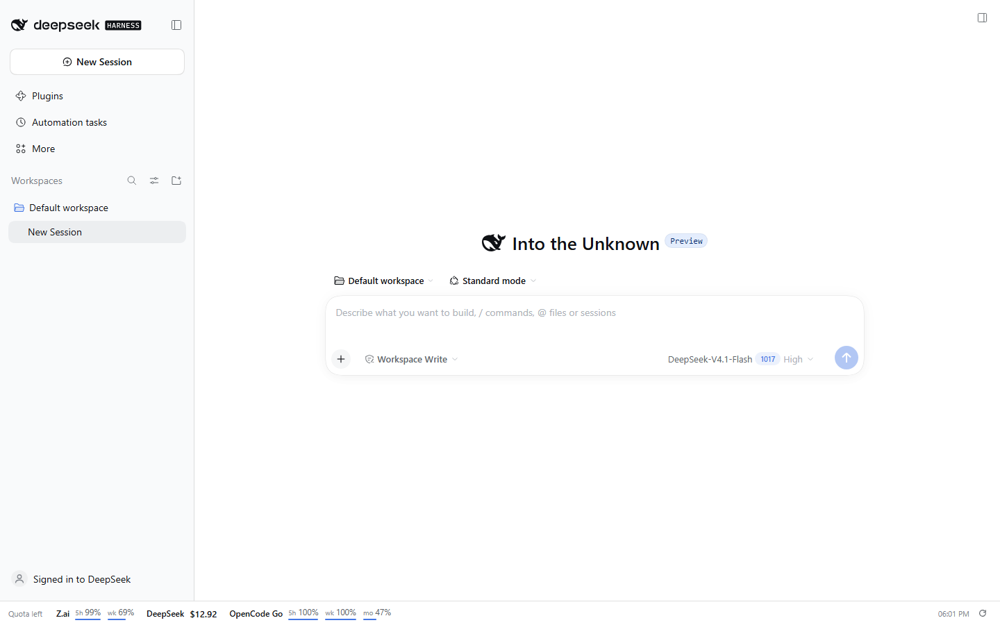
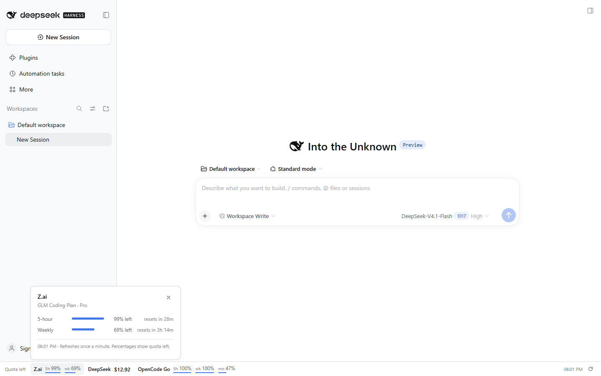
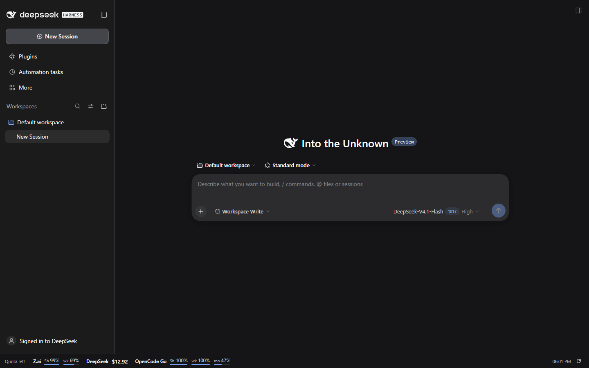

# dsh-quota-bar

<p align="center">All of your z.ai, DeepSeek, and OpenCode Go quota in one compact footer line.</p>

<p align="center">
  <a href="https://www.npmjs.com/package/dsh-quota-bar"></a>
</p>

A DSH plugin that adds a persistent status bar under the workspace. It shows
what is left on each provider at the same time, so you do not have to open
three dashboards or switch models to compare them.



## Why

Coding-plan quota is spread across provider consoles: z.ai has a 5-hour and a
weekly window, OpenCode Go has 5-hour, weekly, and monthly windows, and
DeepSeek API is a prepaid balance. Checking them one by one is slow, and the
numbers only matter when they are about to run out. The bar keeps all three
visible, including the provider you are not currently using.

## What it shows

| Provider | Source | Display |
|---|---|---|
| Z.ai GLM Coding Plan | `api.z.ai/api/monitor/usage/quota/limit` | 5-hour and weekly percent left |
| DeepSeek API | `api.deepseek.com/user/balance` | Wallet balance and availability |
| OpenCode Go | `opencode.ai/zen/go/v1/usage` | 5-hour, weekly, and monthly percent left |

The bar labels the whole row **Quota left**, so a percentage is never ambiguous.
Warnings appear when a window has 15% or less left, and errors at 5% or less.

Click any provider to open a small detail popover with full window names,
progress bars, reset countdowns, and the balance breakdown. `Esc` closes it and
returns focus to the bar.



## Install

### DSH Desktop

Open **Plugins → Install** in the app and paste:

```text
dsh-quota-bar
```

The local checkout path works too, for development:

```text
/path/to/dsh-quota-bar
```

Enable the bundle when the install finishes. Desktop has its own profile, so a
web install does not appear in Desktop and vice versa.

### Web

From npm:

```sh
dsh plugin --profile web add dsh-quota-bar
```

From a local checkout:

```sh
dsh plugin --profile web add /path/to/dsh-quota-bar
```

From GitHub:

```sh
dsh plugin --profile web add "github:damamaty/dsh-quota-bar"
```

Restart `dsh web` after installing a bundle. If `dsh` is not on `PATH`, use the
**Manage dsh Command** entry in the Desktop app first.

## Credentials

The Host reads the keys through DSH's credential service. Add them in
**Settings → Models**, or in `$DSH_HOME\.credentials.yaml`:

```yaml
refs:
  ZAI_API_KEY: ...
  DEEPSEEK_API_KEY: ...
  OPENCODE_GO_API_KEY: ...
```

A provider with no key stays visible as **not set** rather than disappearing.
That is deliberate: the bar always accounts for all three providers.

## Behavior

- Reads every provider in parallel on the Host, caches for 30 seconds, and
  refreshes the page data once a minute.
- Pauses polling while the page is hidden and refreshes when it becomes
  visible again.
- A failed provider keeps its own error state; the other providers still update.
- Supports light and dark themes through the Harness theme tokens, and collapses
  to two rows at narrow widths.



## Security

- API keys are resolved and used only in the Host process. The browser receives
  provider names, percentages, reset times, and balances, never a credential.
- Requests go only to the three provider endpoints above. There is no telemetry
  and no third-party hop.
- Provider error bodies are not echoed into the UI, because some upstream 401
  responses quote part of the key.
- The bar shows your real balances. Treat screenshots and screen shares the same
  way you treat the provider consoles.

## Known limits

- Only z.ai, DeepSeek API, and OpenCode Go are implemented.
- DeepSeek here means the API-key balance. The Platform sign-in wallet shown in
  DSH's account area is a different credential and is not queried.
- OpenCode Go is supported through its Go usage endpoint; Zen pay-as-you-go
  usage is not.
- z.ai window labels come from the plan response. A plan that returns no usable
  window shows an error for that provider.
- Values can lag the provider's own dashboard by up to the polling interval.

## Compatibility

| Host | Version | Status |
|---|---|---|
| Web (`dsh web`) | `0.2.1-rc.3` | Verified 2026-10-26 |
| Desktop | `0.2.1-rc.2` | Installed and confirmed working by the owner (2026-10-27) |
| Other versions | | Unverified |

The package declares no official dependencies; it resolves them from the
installed Harness.

## Plugin management

Install, remove, and toggle with the official tooling, using the same spec you
installed with:

```powershell
dsh plugin --profile web add|remove <spec>
```

Installed plugins are listed on the **Plugins** page in the sidebar. Settings →
Plugins is the read-only inventory.

## Development

The package root is this repository. For local work, use a separate Harness home
and a fixed port so the real profile and session logs stay untouched:

```sh
export DSH_HOME="$HOME/.dsh-quota-bar"
dsh plugin --profile web add /path/to/dsh-quota-bar
dsh web --port 3187 --no-open
```

The client bundle is plain JavaScript, so no build step is required. Restart the
development instance after client changes; reload the page after a data-only
change.

## Source

- npm: [npmjs.com/package/dsh-quota-bar](https://www.npmjs.com/package/dsh-quota-bar)
- GitHub: [github.com/damamaty/dsh-quota-bar](https://github.com/damamaty/dsh-quota-bar)

## License

MIT. See [LICENSE](LICENSE).
